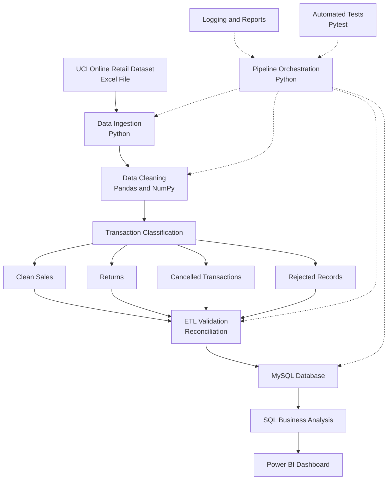

# RetailPulse — System Architecture

## 1. Architecture Overview

RetailPulse is an end-to-end retail analytics platform that transforms raw transaction data into business intelligence.



## 2. Technology Architecture

| Layer | Technology |
|---|---|
| Source | Excel, UCI Online Retail |
| Ingestion | Python |
| Processing | Pandas, NumPy |
| Validation | Python |
| Storage | MySQL |
| Analytics | SQL |
| Visualization | Power BI |
| Automation | Python |
| Testing | Pytest |
| Logging | Python Logging |

## 3. Data Flow

1. Raw Excel transactions are ingested.
2. Data is cleaned and standardized.
3. Transactions are classified into sales, returns, cancellations, and rejected records.
4. ETL validation checks the generated outputs.
5. Validated datasets are loaded into MySQL.
6. SQL queries perform business analysis.
7. Power BI presents the analytical results.

## 4. Quality Assurance

- Duplicate record detection
- Missing-value handling
- Transaction classification
- ETL reconciliation
- Database row-count verification
- Automated unit tests
- Pipeline execution logs

## 5. Execution

Run the complete pipeline:

```powershell
python -m src.automation.run_pipeline
```

Run automated tests:

```powershell
python -m pytest tests/ -v
```
